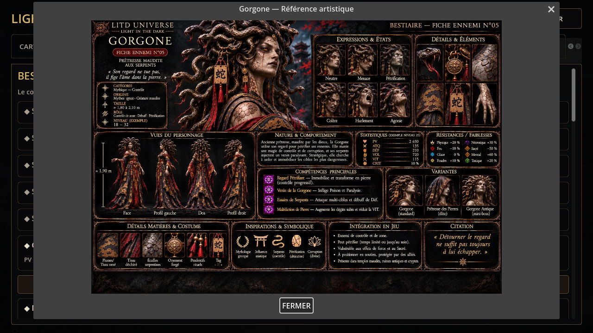
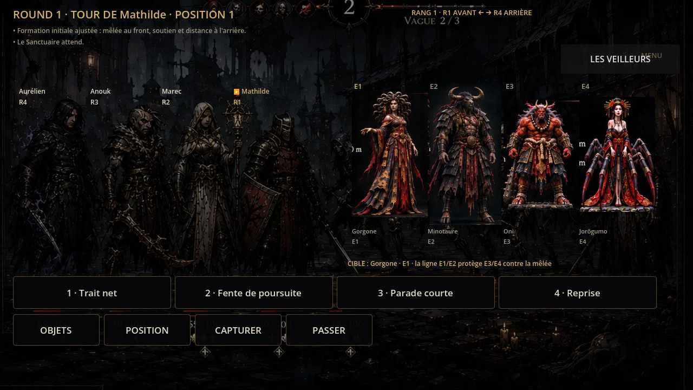

# Correspondance des originaux et du bestiaire actif — 11 novembre 2026

## État vérifié et périmètre

La PR #609 a été fusionnée par la merge queue dans `14f214278b26628e8e9b6d8bdc5b79227d169d02`. Les 21 originaux ont été relus depuis ce commit et leurs SHA-256 comparés au manifeste : 21/21 conformes. Le blocage de transfert est résolu. Le manifeste d'archivage reste le reçu de ce lot, sans activation gameplay ; les correspondances d'affichage vivent dans le registre artistique existant `data/canonical_art_v41.json`.

| ID du jeu | Ennemi existant | Sujet officiel | Numéro imprimé |
|---|---|---|---|
| 6 | Gorgone | gorgon | 5 |
| 7 | Minotaure | minotaur | 4 |
| 8 | Oni | oni | 15 |
| 10 | Jorōgumo | jorogumo | 17 |
| 11 | Yuki-Onna | yuki_onna | 19 |

La correspondance repose sur l'identité nommée, jamais sur le numéro de planche. Aucun ID, nom, PV, dégât, compétence, anatomie, rencontre ou règle de capture n'est remplacé par les annotations imprimées. Les instances capturées utilisent leur `enemy_id`, même après évolution du nom. Les 39 images WEBP restent présentes ; 34 ennemis ne disposent pas de correspondance confirmée dans ce lot. Les cinq autres WEBP sont conservés pour le repli technique et les dépendances historiques.

## Intégration et dépendances

- `CanonicalArtRegistry` résout les cinq identités stables, sans déduction à partir d'un nom libre. Un fichier absent conserve le repli WEBP.
- Les deux rendus hérités de combat (`main.gd`, `main_v30.gd`) utilisent ce résolveur. La fenêtre de cadrage est un `AtlasTexture` : aucune retouche, extraction JPEG, recompression ni modification des originaux. Les coordonnées sont dans le registre ; les bornes sont contrôlées.
- Le slot dynamique v41 `portrait.active_creature` applique le même cadrage. La planche entière reste accessible dans le menu Bestiaire par « VOIR LA PLANCHE » quand la connaissance atteint 5/5, afin de préserver la révélation progressive des annotations.
- Les cinq références de production Blender et leur générateur utilisent les mêmes originaux. Aucun modèle n'est généré par ce changement.
- Les conversions d'ID numériques JSON ont été corrigées dans l'apprentissage du codex et sa liste. Le badge de capture utilise le champ réellement produit par `CreatureManager`.
- Aucun chemin `data/enemies.json` n'est supprimé : les fallback et lecteurs historiques restent valides. Les héros restent quatre jouables ; Éffrie et Lya ne sont pas activées.

## Contrôles exécutés localement

Moteur officiel Linux `4.7.2.stable.official.ed1daf0bf`, archive vérifiée par SHA-512 publié par Godot. Import des ressources terminé sans erreur de script.

- Suite Python complète : 1 843 tests réussis, y compris la non-régression du cache après import.
- `canonical_art_v41_smoke.tscn` : `CANONICAL_ART_V41_SMOKE_OK`. Vérifie les cinq textures et cadrages, le slot dynamique, les captifs, les identités non confirmées, l'absence de déblocage prématuré et la fenêtre du menu réel.
- `canonical_ui_smoke.tscn` : `CANONICAL_UI_SMOKE_OK`.
- Audit projet après import : 59 contrôles réussis, zéro échec. Deux défauts d'audit découverts et corrigés : les sidecars `.import` ne sont pas des originaux ; le dossier `.godot` ne doit pas être lu comme un fichier de configuration.
- Les deux smokes signalent encore 15 instances ObjectDB et 5 ressources retenues à la fermeture ; ces avertissements ne sont pas présentés comme résolus.

## Contrôle visuel réellement effectué

Session native Godot 4.7.2, rendu Compatibility/llvmpipe, fenêtre 1280 × 720, données de test isolées en mémoire (ce n'est pas un parcours complet de campagne). Les cinq planches entières ont été vues dans le jeu ; le bouton réel du codex a ouvert la Gorgone. Fermeture par Échap contrôlée. Le rendu de combat Gorgone / Minotaure / Oni / Jorōgumo a été observé avant et après cadrage. Yuki-Onna : texture/cadrage testés automatiquement et source entière vue ; cadrage de combat non encore observé dans cette session.

Limites visuelles : les régions utilisent les vues de face originales, avec fond noir et quelques fragments des repères de taille imprimés sur les bords. Aucun détourage ni génération n'a été inventé. Le HUD général et ses superpositions ne sont pas certifiés par ce contrôle ciblé. Le premier affichage du scénario de test a nécessité une réouverture du menu pour stabiliser la liste ; le bouton a été contrôlé après cette réouverture.

## Restes et protections

Les 16 autres sujets archivés n'ont pas d'équivalent explicite dans les 39 ennemis actifs. « Tengu » ne démontre pas à lui seul « Karasu-Tengu », et « Loup du Voile » ne démontre pas « Loup décharné / Wendigo ». Pas d'association par ressemblance, de création d'ennemi, de remplacement de boss ni de suppression de ressource. Les PR #606–#608 restent distinctes.

Les exports utilisent toujours `all_resources` ; les nouveaux originaux sont importables et les données JSON sont conservées. Les exports Web/Windows/Linux de ce nouveau changement et leurs workflows restent à contrôler. La PWA est activée : un contrôle en navigateur du cache existant et du renouvellement des ressources reste nécessaire ; aucun cache utilisateur n'a été purgé. Pas de fusion du lot runtime avant les contrôles nécessaires.

Sources primaires consultées le 11 novembre 2026 : [AtlasTexture](https://docs.godotengine.org/fr/4.x/classes/class_atlastexture.html), [AcceptDialog](https://docs.godotengine.org/fr/4.x/classes/class_acceptdialog.html), [merge queue GitHub](https://docs.github.com/en/pull-requests/how-tos/merge-and-close-pull-requests/merging-a-pull-request-with-a-merge-queue?tool=cli). Le comportement est aussi exécuté avec le moteur 4.7.2 ; la documentation 4.x peut décrire des fonctions plus récentes.

Chantier : Bibliothèque artistique LITD 1 — 🟡 À CONSOLIDER. Avancement du chantier actuel : À évaluer. Avancement du projet global LITD 1 : À évaluer. Les 21/21 concernent uniquement l'inventaire des originaux documentés.
