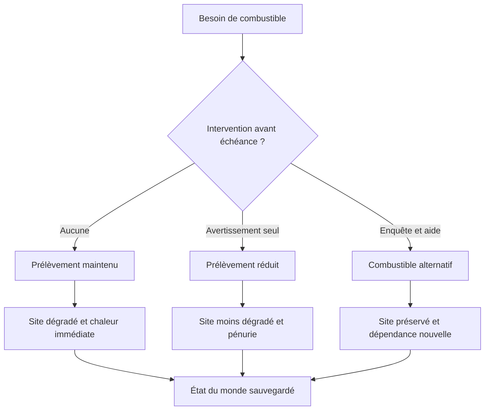

# LITD 1 — Quête pilote : Les cendres du dernier foyer (V0.1)

**Statut : experimental / proposition non canonique.** Date : 2026-11-18. **Aucune implémentation Godot, aucun playtest.**

## Sources internes et limites
- `data/narrative_library.json` : axes `human_stake`, `moral_friction`, `playable_story`, `character_change`, `aftermath`, `originality` ; procédés `conflicting_duties`, `offstage_consequence`, `choice_echo`, `choral_perspective`.
- `data/global_folklore_atlas.json` : extraction de **motifs abstraits seulement** ; ne pas transposer de conte, rituel ou personnage sacré. Aucun emprunt culturel précis n'est autorisé par cette fiche.
- `docs/research/litd1_personnages/SCENARIOS_FICHES_SCENES_CAUSALES_003.md` et `SCENARIOS_GRAPHE_CAUSAL_EMBRANCHEMENTS_004.md` : distinction cause (C), information (I), écho thématique (T), branche (B) ; données documentaires non testées dans les œuvres.
- Grille spécifique Astarion/Shadowheart : **emplacement non vérifié dans cette intervention** ; confrontation exhaustive en attente. Ne pas déclarer cette grille appliquée.

## Hypothèse de conception
Un habitant fictif, **Shen**, entretient un four à charbon dans un hameau isolé. Son activité réchauffe les familles mais épuise une ressource proche d'un ancien site fragile. Le joueur n'est pas le centre de la vie de Shen : ses décisions et celles du hameau évoluent même sans intervention. Noms, lieu et mécanismes sont provisoires ; vérifier la compatibilité avec le canon actuel avant production.

## Variables d'état proposées (non implémentées)
- `phase` : `observed`, `deadline_passed`, `resolved`.
- `intervention` : `none`, `warning_only`, `material_help`.
- `fuel_stock` : entier >= 0 ; `site_integrity` : entier 0..100 ; `villager_trust` : entier -100..100.
- `alternative_fuel_found` : booléen ; `shen_available` : booléen ; `rumor_state` : identifiant persistant.
- `world_tick` : progression déterministe depuis un événement défini ; ne jamais dépendre du temps réel sans décision explicite.

## Trajectoires à comparer
| Branche | Condition initiale | Transition causale | Conséquence observable | Trace persistante |
|---|---|---|---|---|
| A : sans intervention | Aucun échange avant échéance | Shen maintient le four ; le bois se raréfie | Chaleur à court terme, site dégradé et rumeurs | État du site et des réserves ; réputation de Shen |
| B : intervention minimale | Avertissement avant échéance, sans aide | Shen réduit les prélèvements mais ne trouve pas de substitut | Site moins dégradé ; plusieurs foyers manquent de combustible | Tensions entre habitants, confiance divergente |
| C : intervention importante | Enquête et aide matérielle avant échéance | Substitution partielle de combustible et adaptation du four | Ressource préservée, coût d'approvisionnement nouveau | Nouvelle dépendance et dette envers des tiers |

Aucune trajectoire ne constitue une fin parfaitement bonne ; aucun PNJ ne doit attendre indéfiniment l'arrivée du joueur.

## Graphe minimal de causalité

## Contrat de test à implémenter ultérieurement
1. À seed et actions identiques, les transitions et états finaux sont déterministes.
2. Sans interaction, la branche A progresse après l'échéance ; aucune conversation obligatoire ne bloque le monde.
3. Le simple avertissement ne peut pas déclencher les récompenses ou ressources de la branche C.
4. Une intervention importante exige des actions jouées et un coût explicite ; une seule ligne de dialogue ne suffit pas.
5. Sauvegarder et recharger conserve la branche, les variables et les réactions des habitants.
6. Les trois branches donnent au moins deux observations distinctes à court terme et une trace durable vérifiable.
7. Les conséquences sont compatibles avec les systèmes existants ; aucun système parallèle sans audit du runtime.
8. Une revue d'originalité et de sensibilité culturelle est obligatoire avant toute promotion au canon.
9. Une revue des contradictions du canon et des dépendances est obligatoire avant tout développement.
10. Les résultats de tests doivent distinguer PASS, FAIL, SKIP et NOT_RUN, avec traces.

## Validation narrative : grille de lecture
Pour chacune des trois branches, documenter : enjeu humain, autonomie de Shen, causalité, coût moral, recontextualisation, action jouée, réactions des habitants, persistance, distance créative et faisabilité technique. Une affirmation non observée en jeu reste `experimental`.

## Prochaine étape
Retrouver la grille Astarion/Shadowheart exacte ; comparer ses dimensions à la présente fiche, corriger les divergences, puis auditer les systèmes de quêtes et de sauvegarde de `main` avant tout code. **Ne pas promouvoir ce document au canon par simple fusion documentaire.**
