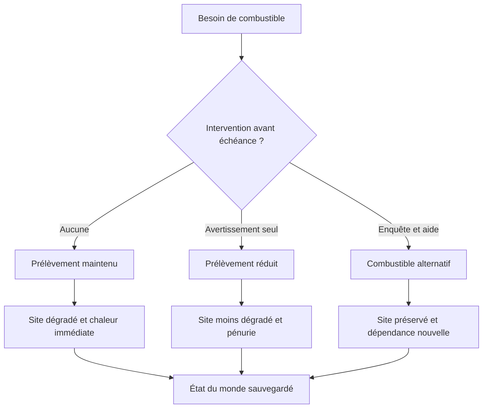

# LITD 1 — Quête pilote : Les cendres du dernier foyer (V0.1)

**Statut : experimental / proposition non canonique.** Date : 2026-11-18. **Aucune implémentation Godot, aucun playtest.**

## Sources internes et limites
- `data/narrative_library.json` : axes `human_stake`, `moral_friction`, `playable_story`, `character_change`, `aftermath`, `originality` ; procédés `conflicting_duties`, `offstage_consequence`, `choice_echo`, `choral_perspective`.
- `data/global_folklore_atlas.json` : extraction de **motifs abstraits seulement** ; ne pas transposer de conte, rituel ou personnage sacré. Aucun emprunt culturel précis n'est autorisé par cette fiche.
- `docs/research/litd1_personnages/SCENARIOS_FICHES_SCENES_CAUSALES_003.md` et `SCENARIOS_GRAPHE_CAUSAL_EMBRANCHEMENTS_004.md` : distinction cause (C), information (I), écho thématique (T), branche (B) ; données documentaires non testées dans les œuvres.
- Grille spécifique Astarion/Shadowheart : `docs/research/litd1_personnages/QUETES_SECONDAIRES_BG3_EMBRANCHEMENTS_GRILLE_004.md`, retrouvée et vérifiée sur la branche source ; douze critères 0–3 / NÉ, preuves et commentaires. Les faits BG3 restent documentaires, non rejoués.

## Hypothèse de conception
Un habitant fictif, **Shen**, entretient un four à charbon dans un hameau isolé. Son activité réchauffe les familles mais épuise une ressource proche d'un ancien site fragile. Le joueur n'est pas le centre de la vie de Shen : ses décisions et celles du hameau évoluent même sans intervention. Noms, lieu et mécanismes sont provisoires ; vérifier la compatibilité avec le canon actuel avant production.

## Variables d'état proposées (non implémentées)
- `phase` : `observed`, `deadline_passed`, `resolved`.
- `intervention` : `none`, `warning_only`, `material_help`.
- `fuel_stock` : entier >= 0 ; `site_integrity` : entier 0..100 ; `villager_trust` : entier -100..100.
- `alternative_fuel_found` : booléen ; `shen_available` : booléen ; `rumor_state` : identifiant persistant.
- `world_tick` : progression déterministe depuis un événement défini ; ne jamais dépendre du temps réel sans décision explicite.

## Trajectoires à comparer
| Branche | Condition initiale | Transition causale | Conséquence observable | Trace persistante |
|---|---|---|---|---|
| A : sans intervention | Aucun échange avant échéance | Shen maintient le four ; le bois se raréfie | Chaleur à court terme, site dégradé et rumeurs | État du site et des réserves ; réputation de Shen |
| B : intervention minimale | Avertissement avant échéance, sans aide | Shen réduit les prélèvements mais ne trouve pas de substitut | Site moins dégradé ; plusieurs foyers manquent de combustible | Tensions entre habitants, confiance divergente |
| C : intervention importante | Enquête et aide matérielle avant échéance | Substitution partielle de combustible et adaptation du four | Ressource préservée, coût d'approvisionnement nouveau | Nouvelle dépendance et dette envers des tiers |

Aucune trajectoire ne constitue une fin parfaitement bonne ; aucun PNJ ne doit attendre indéfiniment l'arrivée du joueur.

## Graphe minimal de causalité

## Contrat de test à implémenter ultérieurement
1. À seed et actions identiques, les transitions et états finaux sont déterministes.
2. Sans interaction, la branche A progresse après l'échéance ; aucune conversation obligatoire ne bloque le monde.
3. Le simple avertissement ne peut pas déclencher les récompenses ou ressources de la branche C.
4. Une intervention importante exige des actions jouées et un coût explicite ; une seule ligne de dialogue ne suffit pas.
5. Sauvegarder et recharger conserve la branche, les variables et les réactions des habitants.
6. Les trois branches donnent au moins deux observations distinctes à court terme et une trace durable vérifiable.
7. Les conséquences sont compatibles avec les systèmes existants ; aucun système parallèle sans audit du runtime.
8. Une revue d'originalité et de sensibilité culturelle est obligatoire avant toute promotion au canon.
9. Une revue des contradictions du canon et des dépendances est obligatoire avant tout développement.
10. Les résultats de tests doivent distinguer PASS, FAIL, SKIP et NOT_RUN, avec traces.

## Validation narrative : grille de lecture
Pour chacune des trois branches, documenter : enjeu humain, autonomie de Shen, causalité, coût moral, recontextualisation, action jouée, réactions des habitants, persistance, distance créative et faisabilité technique. Une affirmation non observée en jeu reste `experimental`.

## Prochaine étape
Auditer les systèmes de quêtes et de sauvegarde de `main` avant tout code ; appliquer la grille QS-004 aux trois trajectoires, puis faire valider les arbitrages narratifs. Les embranchements BG3 doivent être contrôlés sur une version identifiée avant d'être considérés comme vérifiés. **Ne pas promouvoir ce document au canon par simple fusion documentaire.**

## Confrontation avec QS-004 : 12 critères (2026-11-18)

Échelle : **0 absent, 1 faible, 2 correct, 3 fort, NÉ non évalué**. Les notes ci-dessous sont des **estimations de conception sur papier**, pas des résultats de jeu ; aucune somme ni seuil de réussite n'est revendiqué.

| Critère QS-004 | Évaluation préliminaire | Preuve dans la spécification / manque |
|---|---|---|
| 1. Protagoniste PNJ identifiable | 2 | Shen possède un objectif propre ; biographie à approfondir |
| 2. Vie antérieure | 1 | Activité préexistante, histoire personnelle non décrite |
| 3. Motivation cohérente | 2 | Chauffage des foyers versus préservation du site ; contradictions individuelles à écrire |
| 4. Initiative du PNJ | 2 | Trajectoire A évolue sans joueur ; cadence runtime non testée |
| 5. Autonomie décisionnelle | 1 | Réactions de Shen prévues, décision indépendante majeure à préciser |
| 6. Conflit humain/social | 2 | Besoins du hameau et intérêts divergents ; PNJ secondaires à caractériser |
| 7. Révélations préparées | 0 | Aucun indice ni retournement causé par des informations antérieures défini |
| 8. Influence lisible du joueur | 2 | Trois niveaux d'intervention distincts ; UI/feedback non conçu |
| 9. Conséquences persistantes | 2 | Variables et rumeurs définies ; persistance technique non testée |
| 10. Rythme et émotion | 1 | Tension sociale prévue ; scènes calmes, humour et intimité absents |
| 11. Absence de frustration artificielle | NÉ | Échéance déterministe prévue ; lisibilité et justice à éprouver |
| 12. Faisabilité et testabilité | NÉ | Contrat de tests rédigé ; systèmes existants et charge non audités |

### Contradictions et écarts identifiés
1. **Ancienne mention de grille introuvable : corrigée.** QS-004 est désormais accessible dans le même corpus.
2. **Autonomie insuffisamment spécifiée :** la branche sans joueur existe sur papier, mais il manque un choix important pris par Shen indépendamment des options du joueur.
3. **Révélation préparée absente :** le site ancien ne doit pas servir de retournement arbitraire ; écrire des indices et un changement d'interprétation causal avant validation.
4. **Échéance et frustration :** une évolution hors écran est acceptable uniquement si le joueur dispose d'indices raisonnables ; pas de compte à rebours caché punitif.
5. **Compatibilité canonique non établie :** le lieu, Shen et le four restent provisoires ; vérifier les documents maîtres et les systèmes actuels de LITD 1.
6. **Données de recherche versus vérité du jeu :** les branches d'Astarion/Shadowheart sont documentées via une source communautaire, non confirmées par un test direct de BG3.
7. **Statut des quatre héros :** préserver explicitement le rôle particulier de Mathilde, Marec, Anouk et Aurélien ; la quête doit rester celle des habitants.

**Décision documentaire :** grille appliquée à titre exploratoire, quête non approuvée, aucun code produit. Prochaine priorité : combler les critères 5 et 7, puis auditer le runtime et les sauvegardes avant toute implémentation.
