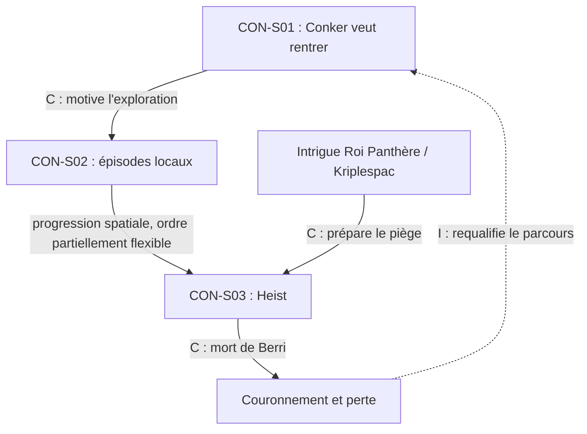
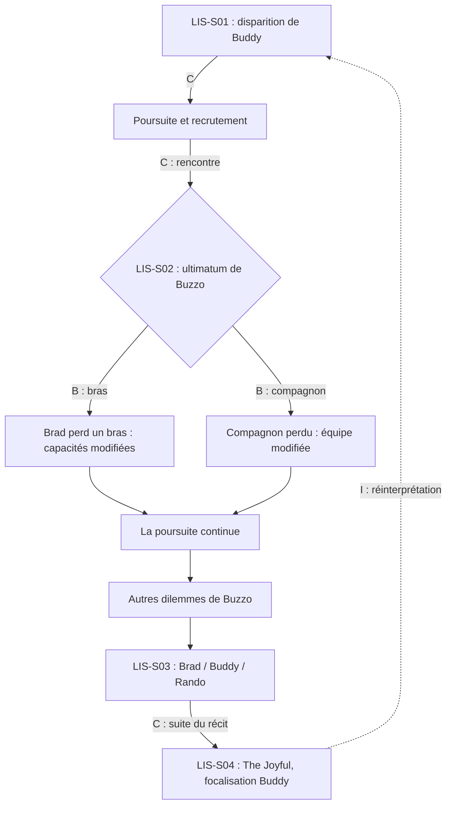
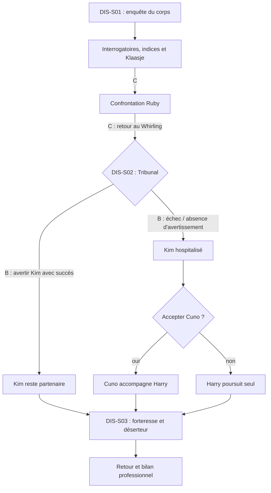

# SCN-004 — Graphe causal et embranchements documentés (première passe)

**18 novembre 2026. 🟡 À consolider. Spoilers.** Graphe **partiel**, limité à des scènes déjà indexées et à trois embranchements documentés. **Aucun jeu exécuté**. Une flèche causale n'est pas synonyme de simple succession.

## Légende
- **C** : cause ou condition nécessaire à la progression / à une conséquence.
- **I** : information nouvelle modifiant la compréhension d'un événement antérieur.
- **T** : écho thématique, sans dépendance obligatoire.
- **B** : branche conditionnelle, résultat dépendant d'un choix ou d'un test.
- **?** : lien provisoire ou non testé.

## 1. Conker : fil principal et épisodes locaux

**Précision :** les épisodes intermédiaires ne sont pas tous des causes du dénouement ; certains sont des détours thématiques ou des obstacles spatiaux. Le fil du Roi Panthère doit être vérifié scène par scène avant d'en faire une causalité exhaustive.

## 2. LISA : branches de sacrifice et focalisation

**Branche documentée :** guide communautaire https://lisa-rpg.fandom.com/wiki/Sacrifices ; autre guide https://maestrosdelmando.com/lisa-the-painful-walkthrough-trophy-guide/ .
**Contradiction à tester :** un choix de sacrifice sans assez de compagnons peut, selon le wiki, ne tuer personne alors que Buzzo réagit comme si des victimes existaient. Ce serait une divergence entre état de jeu et fiction, pas une décision de conception à imiter.
**Autre divergence :** la formulation « tous les objets » ne décrit pas exactement la perte d'équipement selon les guides ; à vérifier en exécution.
**Réserve :** le schéma simplifie les variantes des scènes ultérieures, et ne prouve pas que chaque sacrifice cause le même dénouement.

## 3. Disco Elysium : tronc stable, bifurcations locales durables

**Sources :** wiki du Tribunal https://discoelysium.wiki.gg/wiki/The_Tribunal ; article universitaire Bodi et Thon https://eprints.leedsbeckett.ac.uk/id/eprint/9310/7/PlayingStoriesPV-BODI.pdf ; étude du Tribunal https://uu.diva-portal.org/smash/get/diva2%3A1869962/FULLTEXT01.pdf .
**Effet confirmé documentairement :** le Tribunal demeure une étape obligatoire mais ses victimes et l'état du partenaire changent ; Cuno peut remplacer Kim.
**Branche supplémentaire non dessinée :** arrestation ou libération de Klaasje, qui change sa présence et des informations disponibles, sans modifier l'identité de l'auteur du meurtre.
**Nuance :** la trajectoire d'enquête reste convergente, mais les conséquences sur les personnages sont réelles. Le « tronc stable » ne veut pas dire « choix factices ».

## 4. Audit du rythme et des révélations : hypothèses de lecture
| Segment | Tension | Respiration | Révélation | Point à tester |
|---|---|---|---|---|
| Conker, début et épisodes | Variable, souvent burlesque | Gags et détours | Logique des PNJ | Enchaînements et durée |
| Conker, Heist | Très forte | Métafiction | Agenda de Kriplespac, perte de Berri | Préparation de la tragédie |
| LISA, exploration | Variable | Compagnons, humour | Histoire de Brad | Répétition et fatigue |
| LISA, Buzzo | Forte, choix contraint | Peu | Coût concret de la protection | Frustration des branches |
| Disco, enquête | Alternée | Digressions et relations | Indices progressifs | Charge de dialogues |
| Disco, Tribunal | Forte | Faible | Conséquences des relations et tests | Lisibilité des choix |
| Disco, forteresse | Retombée et révélation | Exploration finale | Auteur et mobile du crime | Satisfaction du dénouement |

**Ces niveaux sont des interprétations qualitatives, non des mesures empiriques.**

## 5. Protocole pour étendre le graphe
1. Relever les scènes unitaires et leurs identifiants stables.
2. Pour chaque lien, conserver une preuve, sa version du jeu et un type C/I/T/B.
3. Pour chaque choix, tester les deux branches et le retour éventuel vers un tronc commun.
4. Relever les effets persistants : personnages, ressources, relations, dialogues, monde.
5. Vérifier les contradictions entre guide et jeu, puis seulement calculer la couverture.
6. Réaliser un audit du rythme après la chronologie complète.

**Limites :** ce graphe n'est pas complet ; le jeu n'a pas été exécuté ; les sources communautaires ne sont pas des tests de branches. **Aucune règle ni scénario LITD 1 validé.**
